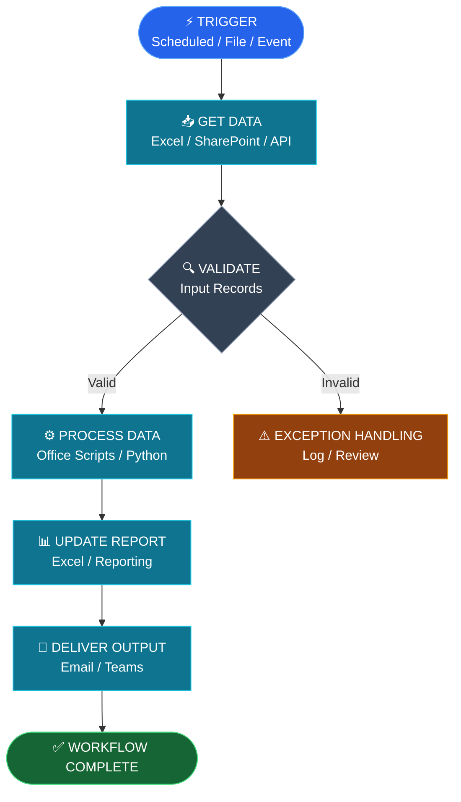

# Dish Dudhat

### IT Specialist | Automation Developer | Cloud Analytics

📍 Toronto, Canada · [LinkedIn](https://www.linkedin.com/in/dish-dudhat) · [Email](mailto:dishdudhat85@gmail.com)

> Building automated workflows that connect business operations, data processing, and cloud technologies.

---

## ⚡ Automation Engineering

I design workflows that transform repetitive business processes into structured, reliable automation.

My work focuses on **Microsoft Power Automate, Office Scripts, Excel automation, data integration, operational reporting, and exception handling**.

### 🔄 Microsoft Power Automate — Workflow Architecture

**Trigger → Retrieve → Validate → Process → Report → Deliver**

*Conceptual architecture illustrating my approach to workflow automation. Individual projects use different triggers and actions.*

---

## 🛠️ Technology Stack

| Engineering Area | Technologies |
|---|---|
| ⚡ Automation | Power Automate, Office Scripts, Excel Automation |
| 🔗 Integration | REST APIs, Webhooks, Data Integration |
| 💻 Programming | Python, JavaScript, SQL |
| 📊 Data Processing | Excel, Data Validation, Data Transformation |
| 🤖 AI Automation | AI-Assisted Workflows, Document Processing (Developing) |
| ☁️ Cloud Analytics | Microsoft Azure, ETL/ELT, SQL Analytics (Learning) |
| 🧪 Exploring | n8n, Power Apps, AI Agents |

---

## 🚀 Featured Automation Projects

### ⚡ 01 — Operations Reporting Automation

**Scheduled Reporting | Data Processing | Workflow Orchestration**

`Power Automate` `Excel` `Data Validation`

**Status:** DOCUMENTED

Converting repetitive operational reporting activities into structured workflows with scheduled execution, validation, and exception handling.

**Workflow:** Scheduled Trigger → Data Collection → Validation → Calculations → Report Generation

---

### 📋 02 — HR Attendance Automation

**Attendance Processing | Exception Management | Office Scripts**

`Power Automate` `Office Scripts` `Excel`

**Status:** EXPERIMENTAL

Automating attendance record processing, shift-based time comparisons, point calculations, and pending-review workflows.

**Workflow:** Input File → Employee Matching → Shift Validation → Point Calculation → Summary Update

Includes exception handling and duplicate-processing safeguards.

---

### 📄 03 — Document-Driven Workflow Automation

**Process Automation | Document Analysis | Workflow Design**

`Power Automate` `Document Processing`

**Status:** PLANNED

Exploring how written business procedures can be translated into structured, scheduled automation workflows.

**Proposed workflow:** Procedure → Requirements → Business Rules → Automation Design → Validation → Execution

---

### 📈 04 — Flow IQ

**Operations Analytics | Activity Processing**

`JavaScript` `Browser Userscripts`

**Status:** PUBLISHED

[View Repository](https://github.com/dudhat52/Flow_IQ-AFTX_AMAZON)

Operational activity analysis, shift-based calculations, productivity monitoring, and exception identification.

---

### 🛍️ 05 — Closio

**Full-Stack Web Application**

`Node.js` `Express` `EJS` `MongoDB`

**Status:** PUBLISHED

[View Repository](https://github.com/dudhat52/Closio-Clothing_store)

A clothing-store web application project exploring server-side development, database integration, and deployment.

---

## ☁️ Cloud Analytics & Data Engineering

**Currently Learning — Microsoft Azure**

I'm expanding my automation background into cloud analytics, focusing on how data is ingested, stored, transformed, validated, and analyzed.

**Learning roadmap**

- [ ] Azure Storage and Data Services
- [ ] SQL Analytics and Data Modelling
- [ ] Cloud Data Ingestion
- [ ] ETL / ELT Pipelines
- [ ] Data Quality and Validation
- [ ] Analytics and Reporting

---

## 🎯 Engineering Philosophy

**Automate repetitive processes. Validate before processing. Make exceptions visible. Keep decisions explainable.**

---

### ⚡ AUTOMATION ENGINEERING × CLOUD ANALYTICS

**Building reliable workflows today. Learning cloud data systems for tomorrow.**

[GitHub](https://github.com/dudhat52) · [LinkedIn](https://www.linkedin.com/in/dish-dudhat) · [Email](mailto:dishdudhat85@gmail.com)

