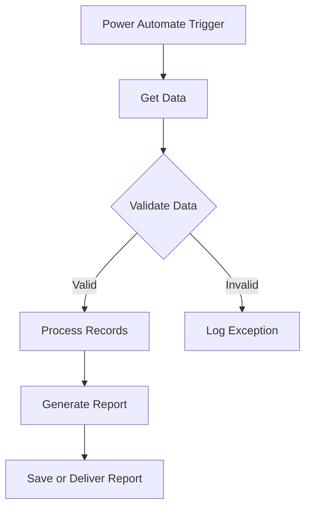

# Dish Dudhat

**IT Specialist | AI Automation Developer | Cloud Analytics **

📍 Toronto, Canada  
[LinkedIn](https://www.linkedin.com/in/dish-dudhat) · [Email](mailto:dishdudhat85@gmail.com) · [GitHub](https://github.com/dudhat52)

---

## About Me

I work in IT and develop automation solutions that simplify business processes, improve operational reporting, and reduce repetitive manual tasks.

My work focuses on **Microsoft Power Automate, Office Scripts, Excel, Python, JavaScript, and data integration**.

I enjoy building workflows that collect information, validate records, process data, handle exceptions, and generate useful reports.

I'm currently expanding my skills in **Cloud Analytics and Data Engineering**, with a focus on Microsoft Azure, SQL, data pipelines, and reporting.

---

## Technical Skills

| Category | Technologies |
|---|---|
| Automation | Power Automate, Office Scripts, Excel Automation |
| Programming | Python, JavaScript, SQL |
| Data | Excel, Data Validation, Data Transformation |
| Integration | REST APIs, Webhooks |
| AI Automation | AI-Assisted Workflows, Document Processing (Developing) |
| Cloud Analytics | Microsoft Azure, SQL Analytics, Data Engineering (Learning) |
| Exploring | n8n, Power Apps, AI Agents |

---

## My Automation Workflow

This is a simplified example of how I design automation workflows using Microsoft Power Automate.

The goal is to create reliable workflows with accurate data, clear exception handling, and minimal manual intervention.

---

## Featured Projects

### 1. Flow IQ — Operations Analytics

**Technologies:** JavaScript, Browser Userscripts  
**Status:** Published

[View Repository](https://github.com/dudhat52/Flow_IQ-AFTX_AMAZON)

An operations analytics project focused on activity records, productivity monitoring, shift-based calculations, and identifying operational exceptions.

### 2. Operations Reporting Automation

**Technologies:** Power Automate, Excel, Data Processing  
**Status:** Documented

An automation project focused on simplifying repetitive reporting tasks through scheduled workflows, data validation, calculations, and report generation.

### 3. HR Attendance Automation

**Technologies:** Power Automate, Office Scripts, Excel  
**Status:** Experimental

An attendance-processing automation that supports:

- Late-arrival detection
- Employee record matching
- Attendance point calculations
- Pending-review tracking
- Exception handling
- Duplicate-processing prevention

The objective is to improve reporting consistency while keeping exceptions available for human review.

### 4. Document-Driven Workflow Automation

**Technologies:** Power Automate, Document Processing  
**Status:** Planned

A new automation project focused on converting written business procedures into structured automated workflows.

The planned solution includes requirement analysis, workflow design, validation, exception handling, and scheduled execution.

### 5. Closio — Clothing Store

**Technologies:** Node.js, Express, EJS, MongoDB  
**Status:** Published

[View Repository](https://github.com/dudhat52/Closio-Clothing_store)

A full-stack web development project focused on application structure, dynamic content, database integration, and deployment.

---

## Cloud Analytics & Data Engineering

I'm currently learning cloud analytics and exploring how cloud platforms can support data processing, storage, transformation, and reporting.

My goal is to combine automation engineering with cloud analytics to develop reliable, data-driven systems.

---

## Contact

**Email:** dishdudhat85@gmail.com  
**GitHub:** [github.com/dudhat52](https://github.com/dudhat52)  
**LinkedIn:** [linkedin.com/in/dish-dudhat](https://www.linkedin.com/in/dish-dudhat)

---

**Automating processes. Validating data. Building reliable systems.**
